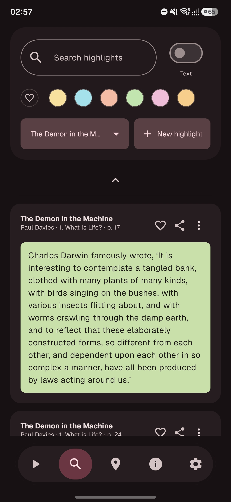
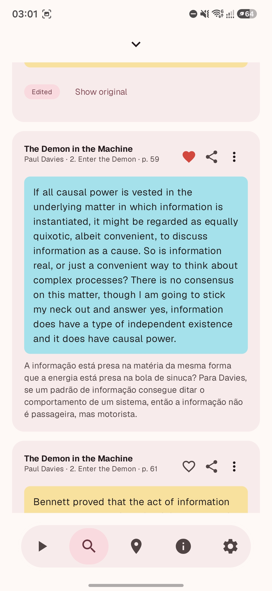
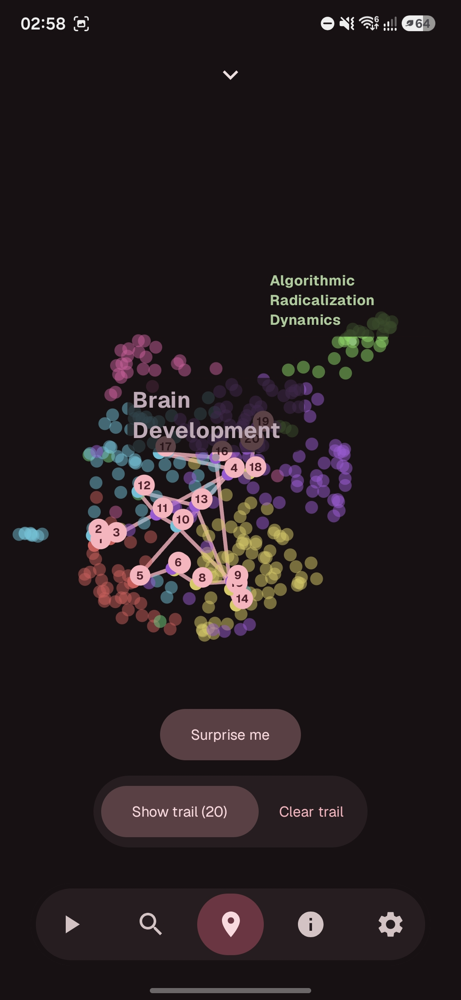
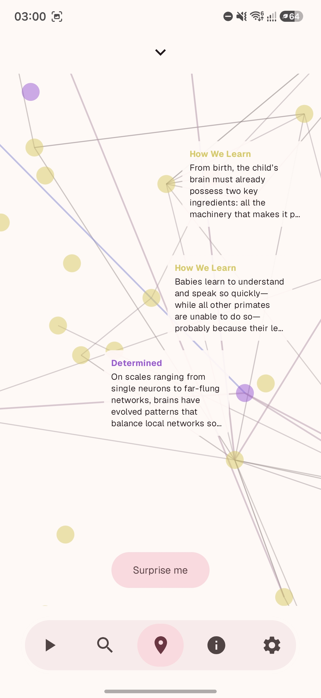
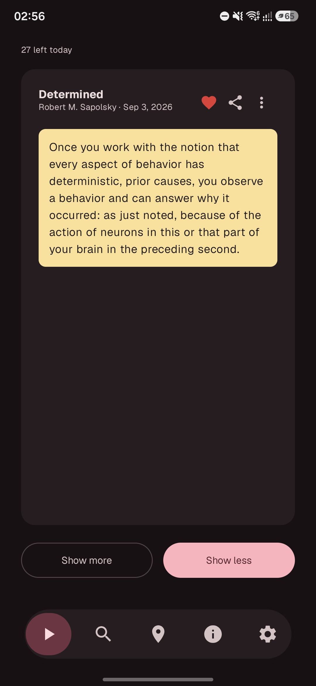
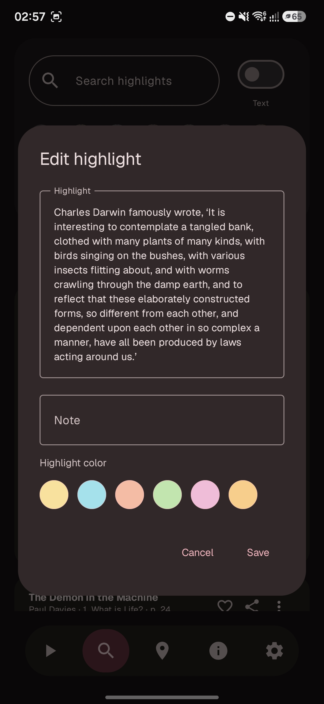

# Wiseworm

**Rediscover what you've read. Connect ideas. Keep knowledge close.**

You read, highlight, take notes... and eventually forget where you saved that life-changing quote. **Wiseworm** changes that. It brings your book highlights together into one intelligent Android app, turning scattered passages into a living web of knowledge.

## Screenshots

| Library (Dark) | Library (Light) | Map (Dark) |
| :---: | :---: | :---: |
|  |  |  |

| Map Detail (Light) | Review (Dark) | Edit Dialog (Dark) |
| :---: | :---: | :---: |
|  |  |  |

---

## Why You'll Fall in Love with Wiseworm

- **📚 Unified Library:** Import your notes from Kindle and Google Play Books. All your best passages organized, searchable, and always at your fingertips.
- **🧠 Semantic Search:** Can't remember the exact phrase? No problem. Type an idea or a question (like *"How do institutions shape society?"*) and find the exact passage by meaning, not just keywords.
- **🗺️ Interactive Idea Map:** Visualize your reading as an interconnected universe of concepts. Discover invisible bridges between different books and explore thematic islands born from your notes.
- **🔄 Effortless Spaced Review:** Revisit what you've read at the ideal pace. The app schedules intelligent reviews to help knowledge truly stick in your memory without the grind.
- **📊 Habits & Growth:** Track your reading streak, review consistency, and intellectual diversity across topics.

---

## Your Library, Your Rules

Your data stays **stored directly on your device**, ensuring absolute privacy. Cloud and AI features are entirely optional and only active when you choose.

- **Requirements:** Android 14.0 or later.
- **Languages:** English, Brazilian Portuguese, and Spanish.

---

## Download and Transform Your Reading

Breathe new life into your highlights. Install Wiseworm, bring in your first book, and discover a whole new way to converse with the authors who inspire you.

---

  Copyright © 2026 <strong>Wiseworm</strong>. All rights reserved.

